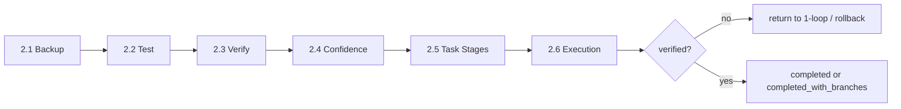

# 2-loop - Execution

## 读取顺序

1. `../AGENTS.md`
2. `README.md`（本文件）
3. 按步骤文档执行：2.1-backup → 2.2-test → 2.3-verify → 2.4-confidence → 2.5-task-stages → 2.6-execution

## 角色

- 执行前备份
- 执行中测试和验证
- 置信度检查
- 阶段推进和状态写回
- 执行 sub 的边界约束

## 行动准则（2-loop 专用）

### 整洁规范
- 文件结构正交、分类清晰、先复用后新建
- 旧系统崩坏的根因之一是文件混乱

### 过程可见
- 做事前展示计划→理由，做完给反馈→证据
- 每次执行变更必须反馈：做了什么、为什么、结果如何

### 诚实第一
- 假装完成 = 往方程里填假数据 = 整个系统的预测能力崩塌
- 承认失败，安全回滚

## 子模块流程图

## 不是它的职责

- 不定义 2-loop 的统一标准层
- 不替代 scripts/single_loop_brain.py
- 不把项目级规范写成 2-loop 的固定前置层
