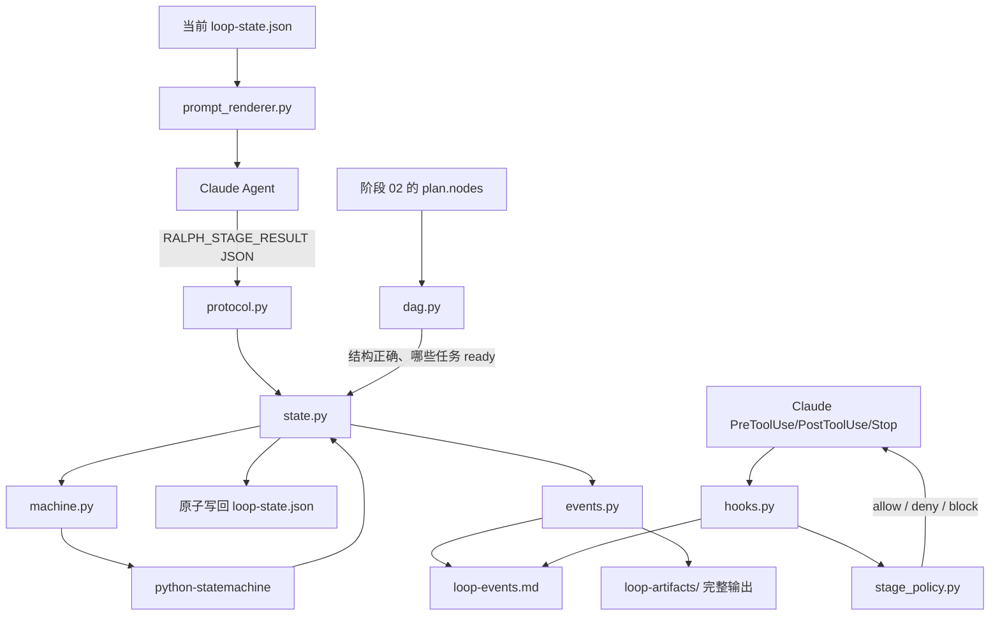

# RALPH Runtime：状态机、Prompt、DAG 与 Hook 的关系

这个目录实现的是 RALPH 的第一个可运行 MVP。

它的目标不是让 Python 重新实现一套 Agent，而是把下面这条边界固定下来：

```text
Agent 负责理解任务、执行工作、提交结构化结果
运行时负责验证结果、判断转换是否合法、保存状态、记录事件
Claude Hook 负责控制工具调用是否可以发生
```

你的原始理解基本是对的：最终应该主要设计“节点、条件、分支、回传信息”，由状态机框架执行其余的状态转换。当前目录中的 Python 文件之所以比较多，是因为状态机库本身只负责“内存中的状态和事件转换”，并不负责理解 Claude 的 JSON、写项目状态文件、记录 Markdown 日志或解析 Claude Code Hook。因此，其余文件大多是适配层，不是另一套状态机。

## 1. 先给结论：哪些是状态机，哪些不是

真正属于工作流定义和状态转换的核心只有两层：

| 文件 | 是否是状态机核心 | 作用 |
|---|---:|---|
| `nodes.py` | 是，定义层 | 定义有哪些流程节点、每个节点需要什么输入和输出、成功/失败/人类阻塞后去哪 |
| `machine.py` | 是，执行层 | 使用 `python-statemachine` 把节点之间的合法转换表达成状态和事件 |

其余文件是外围适配：

| 文件 | 作用 |
|---|---|
| `protocol.py` | 把 Agent 返回的 JSON 解析成安全的动作，并检查动作字段 |
| `prompt_renderer.py` | 把当前状态渲染成给 Agent 的 Prompt，并计算 Prompt 哈希 |
| `contracts.py` | 把阶段编译为可检查的语义分解契约和子代理任务卡 |
| `state.py` | 把状态机的结果保存到项目级 `loop-state.json`，并从旧格式迁移 |
| `events.py` | 把每次动作、工具观察和 Agent 输出摘录保存到 `loop-events.md`，并支持重放 |
| `task_board.py` | 只读解析项目 `tasks/TASKS.md`、选择 ready 任务，并在合法接续后原子 claim |
| `dag.py` | 检查阶段内部的动态任务图是否能执行；它不是主流程状态机 |
| `stage_policy.py` | 描述某个角色在某个阶段能否使用某个工具 |
| `feedback.py` | 把拦截原因统一渲染为错误码、修正动作、唯一下一步和禁止事项 |
| `decomposition_benchmark.py` | 对简单任务做语义完整性评分；它不替代协议校验，也不做领域推荐 |
| `hooks.py` | 把 Claude Code 的 Hook JSON 接到运行时策略上 |
| `result_artifacts.py` | 将阶段提交按 `stage/revision` 归档，并限制结果工件只能从受控目录校验 |
| `replay_runner.py` | 用固定 Fixture 重放 Prompt 和动作，验证行为是否稳定 |
| `cli.py` | 提供 `ralph init/status/events/task-next/apply/replay/hook/start/resume/run` 命令 |
| `templates/stage_prompt.md` | Agent 实际看到的 Prompt 模板 |
| `tests/` | 验证上面各层，不参与运行时决策 |

换句话说：

```text
nodes.py       = 你设计的流程图
machine.py     = 状态机框架的运行实例
protocol.py    = Agent 和状态机之间的消息翻译器
contracts.py   = 阶段契约和受控子代理任务卡生成器
state.py       = 状态机结果的项目文件适配器
events.py      = 审计日志和恢复记录器
task_board.py  = 项目任务板扫描和接取适配器
dag.py         = 阶段内部任务图检查器
hooks.py       = Claude Code 工具准入适配器
cli.py         = 人和 Shell 使用运行时的入口
```

## 2. 完整数据流



一次正常的阶段推进是：

```text
1. 运行时读取 loop-state.json
2. prompt_renderer.py 根据当前 stage 生成 Prompt
3. Agent 执行当前阶段
4. Agent 返回 RALPH_STAGE_RESULT
5. protocol.py 解析并检查字段
6. state.py 调用 machine.py 判断这个动作在当前节点是否合法
7. python-statemachine 执行状态转换
8. state.py 生成新的状态快照
9. events.py 记录动作和输出
10. 原子写回 loop-state.json
```

如果第 5 步或第 6 步失败，状态不会被写入。运行时会生成修复 Prompt，让 Agent 重新按协议返回结果。

错误反馈的具体设计和真实错误对照表见 [`loop/ralph-feedback-prompts.md`](../../loop/ralph-feedback-prompts.md)。反馈不是泛化的“请重试”：有 pending 任务卡时只反馈派发动作，有 dispatched 卡时只反馈等待动作，门禁回执错误只反馈回执模板，基础设施错误只反馈短上下文恢复。

## 2.1 新增：主动澄清、受控派发与事实账本

Prompt 不再只是“当前阶段 + 最终 JSON”。运行时会为每个阶段生成可检查的合同文件：

```text
01 语义分解与需求审计
   → 必派 requirements-auditor
02 DAG 与任务卡审计
   → 必派 dag-auditor
03 按 ready DAG 节点受控研究
   → 每个 Agent 只能读取指定 task card；全部完成后必派 execution-join-auditor
04 事实账本与交叉验证
   → 必派 evidence-verifier
05 可追溯决策
   → 必派 decision-auditor
06 交接与候选队列
   → 必派 handoff-auditor
探索与任务接续
   → 必派 exploration-auditor；先扫描 tasks/TASKS.md，再接取或生成 candidate
```

语义分解按“背景、决策对象、目标、比较集合、约束、交付物、不确定性”展开，而不是把每个词无限拆开。一个叶节点只要已经可以被确认、合理推断、向人追问、显式假设或转为可验证研究任务，就停止继续拆分。

01 阶段现在有明确的“需求分流闸门”：

```text
输入/历史补充 → 项目状态/文档 → 本地环境/配置 → 工具研究
→ 高置信推断 → 默认假设/敏感性场景 → 必要时才问人类
```

问题只有在“无法确认、无法推断、无法研究、会改变关键决策、且不能用场景覆盖”这四项同时成立时才允许出现。比如任务已经明确要购买本地 GPU，不能再问是否购买硬件；候选范围已经列出云服务，不能再问是否比较云服务；模型档位未知时，应先读取本地配置，仍未知则建立 30–35B 和更大模型场景，把内存需求列为研究任务。`attribute_matrix.disposition` 现在支持 `inferred`，并要求提示中记录证据、置信度、影响和可逆性。

每个项目都会生成：

- `loop-artifacts/contracts/task-spec.json`：当前任务的规范输入。后续人类消息会追加为权威输入，旧资料不能自动变成当前约束。
- `loop-artifacts/contracts/<stage>-<revision>-stage-contract.md`：Commander 的当前阶段契约。
- `loop-artifacts/contracts/<stage>-<revision>-stage-input-package.json`：交给独立审计代理的有界输入包；不包含 Commander 主对话、隐藏推理或无关运行历史。
- `loop-artifacts/contracts/<stage>-<revision>-submission-template.json`：Commander 必须复制并填写的唯一阶段提交模板。
- `loop-artifacts/task-cards/*.md`：子代理只能读取的边界化任务卡。
- `loop-artifacts/stages/<stage>/<revision>/`：本阶段本轮的结构化提交和失败尝试工件；运行时自动写入，不能用它绕过 Hook。

在强制模式下，裸 `Agent` 调用会被拒绝。Commander 必须以任务卡路径作为 Agent prompt 的第一行：

```text
RALPH_TASK_CARD=loop-artifacts/task-cards/01-r1-requirements-auditor.md
先读取该任务卡与其中列出的文件；只在其边界内执行。
```

子代理卡完成前，当前阶段不能 `advance`。每个阶段还需要一个 `is_stage_gate=true` 的独立审计卡，其提交的 `stage_review` 必须是 `pass/advance`、所有检查都通过且没有阻塞发现。`deep-research` 只属于 03 的广覆盖发现层；进入最终推荐的关键事实仍必须在 04 中记录来源、日期、适用条件和核验状态。

任务卡的生命周期是机械状态，不是模型可以自行解释的提示：

```text
pending → PreToolUse 允许一次 Agent → dispatched
         → SubagentStart 绑定 agent_id
         → SubagentStop 验证回执 → completed / failed
```

因此，`dispatched` 不等于人类阻塞，也不允许通过再次派发、用 Agent 创建任务卡或直接 Write 阶段契约来“修复”。这些文件由运行时生成；若文件确实缺失，应报告运行时问题或在新上下文中恢复。

事件日志是追加式审计记录，但不能作为每轮 Prompt 的全文输入。Commander 直接读取 `loop-events.md` 会被 PreToolUse 拒绝；使用有界摘要：

```bash
ralph events <project> --tail 20
```

该命令只返回最近事件的类型、阶段、任务卡生命周期、短错误信息和有限输出摘录。PostToolUse 记录也只保留生命周期字段和截断结果，不把完整工具响应复制进 `loop-events.md`。已有历史不会被删除；完整阶段输出会按 `loop-artifacts/stages/<stage>/<revision>/` 保存，但主上下文只应消费摘要。

### 阶段结果工件：为什么不让 Commander 直接 Write/Edit

阶段结果可以落盘，但写入边界必须由 runtime 管理。Stop Hook 会把每次阶段结果（包括非法尝试）保存到当前阶段目录，例如：

```text
loop-artifacts/stages/01/r1/<event-id>.agent-output.md
loop-artifacts/stages/01/r1/<digest>.invalid-agent-output.md
```

需要机械检查某个结果时运行：

```bash
ralph validate <project> --result loop-artifacts/stages/01/r1/submission.json
```

只有校验通过才允许原子应用：

```bash
ralph validate <project> --result loop-artifacts/stages/01/r1/submission.json --apply
```

`--apply` 会再次验证当前 `loop-state.json`、阶段 revision、任务卡、字段契约和 DAG 条件，然后调用同一套 `apply_and_record`。因此它不是第二条状态写入路径；它只是把“文件化提交”接到现有协议。Commander 仍不能用任意 `Write/Edit` 修改工件、状态或契约。

### 拦截并不依赖语义关键词

Hook 的可执行拦截依据是结构化状态，不是“Agent 名字像不像研究员”或“Prompt 包不包含调研”这类脆弱关键词：

```text
当前阶段 + 角色 + 工具名 + 目标路径
→ Agent 首行的批准任务卡引用
→ 任务卡当前生命周期（pending/dispatched/completed/failed）
→ 阶段推进时的固定提交模板、字段 Validator、独立门禁回执
```

`RALPH_TASK_CARD=...` 是唯一故意使用的文本标记：它只是卡片 ID 的传递接口，随后会被拿去和 `loop-state.json.subagent_cards` 中的已批准记录精确匹配。它不是靠关键词猜测 Agent 的意图。

### 为什么独立审计不能“完全没有上下文”

完全没有输入的代理无法判断输出是否满足输入，结果只会退化为机械检查。因此门禁代理采用“无主对话上下文、最小阶段上下文”：只给阶段输入包、阶段契约和提交模板，不给 Commander 的叙述、推理链或其他阶段的无关材料。它应当输出 `pass`、`rollback` 或 `blocked_human`；只有 `pass` 才能让 Commander 填写并提交 `advance` 模板。

## 3. `nodes.py`：你设计的“图结构”在哪里

`nodes.py` 是当前 MVP 中最接近你设想的文件。

一个 `LoopNode` 描述一个固定流程节点：

```python
LoopNode(
    id="02",
    name="任务分解",
    input_description="已确认目标和约束",
    required_outputs=("task_graph", "coverage_proof"),
    success_condition="任务图无遗漏、无冲突且可验证",
    failure_condition="分解不完整或存在冲突",
    on_success="03",
    on_failure="02",
    on_human_block="exploration",
)
```

这对应你的设计：

```text
当前节点：02
输入：已确认目标和约束
成功输出：task_graph、coverage_proof
成功：进入 03
失败：回到 02，产生新的 revision
人类阻塞：进入 exploration，先做其他可执行工作
```

当前 `DEFAULT_GRAPH` 包含：

```text
01 目标与约束       → 02
02 任务分解         → 03
03 子任务执行       → 04
04 验证与交叉验证   → 05
05 决策             → 06
06 交接与队列       → exploration
exploration         → 01（选定任务后）
```

06 不再直接跳到 `completed`；它先进入探索尾节点，避免一个任务完成后循环停止。探索节点先扫描项目任务板，有任务则接续，没有任务才输出候选目标。

`ralph task-next <project>` 是只读扫描命令：它返回 `tasks/TASKS.md` 中最高优先级且依赖已满足的 ready/pending 任务。结构化探索动作通过校验后，运行时才会原子地 claim 该行，并把接取来源写入 `task_intake`、`task_intake_history` 和事件日志。

没有可接任务时，Agent 返回 `preference_brief` 和带 `candidate` 标记的候选任务；候选不会静默进入 `01`，只有明确 `human_approved=true` 才能作为新任务进入 01。

这里的 `success_condition` 和 `failure_condition` 目前是“给 Prompt 和日志看的描述”，不是 Python 可以自动执行的逻辑。当前真正执行的合法性检查是：

- Agent 是否返回了合法动作。
- 动作声明的当前阶段是否与 `loop-state.json` 一致。
- `advance` 是否指向允许的下一节点。
- `rollback` 是否指定了回滚节点。
- `skip_blocked` 是否真的发生在 `blocked_human` 状态。

例如，状态机不会仅凭字符串“证据充分”自动判断证据充分。要做到真正自动判断，需要把条件进一步写成可执行 Guard，例如：

```python
def verification_passed(context: dict) -> bool:
    return (
        context["verification_report"]["status"] == "passed"
        and len(context["verification_report"]["evidence"]) >= 2
    )
```

这是下一步可以增强的地方。自然语言条件可以继续保留给 Agent，但机器条件必须有对应的函数、规则或 Validator。

## 4. `machine.py`：真正调用的状态机框架

`machine.py` 才是直接使用 `python-statemachine` 的文件。

它把固定阶段声明为状态：

```python
stage_01
stage_02
stage_03
stage_04
stage_05
stage_06
blocked_human
exploration
completed
stopped
```

把允许的变化声明为事件：

```python
advance_01 = stage_01.to(stage_02)
rollback_02 = stage_02.to(stage_01)
block_02 = stage_02.to(blocked_human)
skip_to_03 = blocked_human.to(stage_03)
explore_02 = stage_02.to(exploration)
```

因此 Agent 不能直接说“我现在想从 02 跳到 06”，除非图中存在这个转换。`machine.py` 会拒绝没有定义的转换。

当前 MVP 采用固定六阶段状态机，是为了先稳定验证 Prompt 动作复现。它不是最终形式。最终可以改成：

```text
读取 JSON/Markdown 中的节点定义
→ 自动生成状态和转换
→ 由通用 StateMachine 执行
```

这样以后增加阶段时不需要同时修改 Python 类和文档。

## 5. `protocol.py`：为什么框架之外还要有字段校验

状态机框架知道“事件是否允许发生”，但它不知道 Claude 返回的文本是什么，也不知道你的动作协议需要哪些字段。

`protocol.py` 负责把以下内容转换成 `ActionResult`：

```xml
<RALPH_STAGE_RESULT>
{
  "action": "advance",
  "status": "passed",
  "stage_id": "02",
  "revision": "r1",
  "next_stage": "03",
  "evidence": [],
  "artifact_refs": [],
  "message": "任务图已经完成验证"
}
</RALPH_STAGE_RESULT>
```

它检查：

- 是否是 JSON 对象。
- 是否有 `action/status/stage_id/revision`。
- `action` 是否属于允许集合。
- `evidence` 和 `artifact_refs` 是否是数组。
- `advance` 是否有 `next_stage`。
- `rollback` 是否有 `rollback_to`。
- `skip_blocked` 是否有 `next_stage`。
- `candidate` 是否有 `title/research_summary/reason`。
- Agent 声明的阶段是否仍是当前阶段。

所以它不是业务状态机，而是“Agent 输出的类型检查器”。

你说的“字段校验应该由框架具备”需要区分两种校验：

| 校验类型 | 适合由谁负责 |
|---|---|
| `stage_02` 能否执行 `advance_02` | `python-statemachine` |
| JSON 是否有 `next_stage` | `protocol.py` 或 JSON Schema |
| 当前阶段是否有 `task_graph` | 阶段 Validator/Guard |
| 任务图有没有环 | `dag.py` |
| 两个并行任务是否写同一个文件 | `dag.py` |
| Claude 是否能调用 `Edit` | `stage_policy.py` + Hook |

状态机库可以提供 Guard、Callback 和 Action 的执行位置，但不会自动从自然语言 Prompt 推导出这些领域规则。

## 6. `prompt_renderer.py`：它不是状态机，是 Prompt 编译器

`prompt_renderer.py` 做三件事：

1. 读取当前 `loop-state.json.stage`。
2. 把完整阶段信息、计划和允许动作注入 `stage_prompt.md`。
3. 对最终 Prompt 计算 SHA-256。

它解决的是“同一个状态必须生成同一个 Prompt”的稳定性问题。

例如当前状态为 `02/r1`，它会把：

```text
阶段编号、阶段名称、输入、必需输出、成功条件、失败条件、回滚目标、当前 plan、允许动作
```

全部放入 Agent 的上下文中，而不是要求 Agent 自己从全局文档猜当前状态。

Prompt 渲染器不负责：

- 判断任务是否完成。
- 写 `loop-state.json`。
- 派发子 Agent。
- 阻止工具调用。

它只负责生成稳定输入。

## 7. `state.py`：为什么状态机不能直接替代它

`python-statemachine` 的状态通常存在 Python 对象内存中。进程退出后，框架并不知道项目下的：

```text
loop-state.json
loop-events.md
当前 plan
候选任务队列
active_tasks
历史 revision
artifact 引用
```

`state.py` 是“应用状态适配器”，负责：

- 初始化不存在的 `loop-state.json`。
- 迁移旧版状态格式。
- 读取当前状态。
- 调用 `machine.py` 判断转换是否合法。
- 把转换结果物化成新的 JSON。
- 使用临时文件和原子替换写回，避免中途写坏状态。
- 保存当前阶段的完整信息，而不是只保存 `stage_id`。

因此它不是重复实现状态机，而是把内存状态机接到项目文件系统。

状态文件的关系是：

```text
PromptWorkflowMachine = 当前这一次运行中的状态机对象
loop-state.json       = 可恢复、可检查、可跨进程传递的状态快照
```

当 Agent 中途停止时，新的进程读取 JSON 就可以知道从哪里继续。

## 8. `events.py`：为什么还要有事件日志

`loop-state.json` 只保存“现在是什么状态”。它不适合保存全部过程。

`events.py` 记录“状态为什么变成现在这样”：

```text
02-r1 阶段开始
02-r1 Agent 提交第一次分解
02-r1 验证失败
02-r2 重新分解
T1.1/T1.2 并行派发
J1 Join
阶段推进到 03
```

它会：

- 向 `loop-events.md` 追加固定格式的 Markdown 事件。
- 保存 Agent 输出摘录。
- 把完整输出保存到 `loop-artifacts/stages/<stage>/<revision>/<event-id>.agent-output.md`。
- 保存状态前后哈希。
- 记录动作、验证结果和 artifact 引用。
- 记录会话输入，以及任务卡派发、绑定、完成和恢复等可观察生命周期。
- 从事件日志重放出状态，检查日志与状态是否一致。

它不记录隐藏思维过程，只记录可观察的 Agent 输出、工具结果和结构化产物。

典型调用路径是：

```python
events.apply_and_record(
    state_path="/project/loop-state.json",
    event_path="/project/loop-events.md",
    raw_action=agent_result,
    raw_output=agent_full_output,
)
```

这里的顺序是：

```text
解析 → 验证 → 触发状态机 → 生成事件 → 原子写状态
```

如果解析或转换失败，函数会在写入前抛错，因此非法动作不会改变状态。

## 9. `dag.py`：DAG 到底是什么

DAG 是 Directed Acyclic Graph，中文是“有向无环图”。它不是另一个 Prompt，也不是主流程状态机。

主流程状态机回答：

```text
现在处于 01、02、03 还是 04？成功后去哪？失败后回哪里？
```

DAG 回答：

```text
当前阶段内部要做哪些子任务？哪些可以并行？哪些必须等待？什么时候 Join？
```

例如阶段 02 分解出：

```text
T1.1 显卡价格区间
T1.2 显卡驱动分类
T2   汇总两个结果
```

图结构是：

```text
T1.1 ─┐
      ├─→ T2
T1.2 ─┘
```

`T1.1` 和 `T1.2` 可以属于同一个并行组 `G1`，因为它们：

- 输入边界不同。
- `orthogonal_key` 不同。
- 输出不互相覆盖。
- 可以独立验证。

`T2` 是 Join 后的串行任务，它接收两个上游输出。

`dag.py` 当前会检查：

- 任务 ID 是否重复。
- `depends_on` 是否引用不存在的任务。
- `parent_id` 是否存在。
- 是否有环。
- 跨层依赖是否声明 `input_refs` 和 `output_schema`。
- 并行组是否至少有两个任务。
- 并行组中是否混入串行任务。
- 并行任务是否都声明了不同的 `orthogonal_key`。
- 不同任务是否写同一个路径。
- 当前有哪些任务已经 ready。

所以，回答“它能不能校验任务分解图结构”：

```text
能校验结构可执行性：能
能校验依赖、环、并行正交和写冲突：能
能自动判断现实世界中的任务是否真的完整：不能，仅凭图结构不能证明语义完备
```

“显卡价格区间和驱动分类确实覆盖了用户问题”属于语义覆盖证明，需要 Agent 产出 `coverage_proof`，或由额外的领域 Validator/Review Agent 判断。`dag.py` 只能验证这个证明所依赖的图没有明显结构错误。

## 10. 为什么 DAG 不直接放进 `machine.py`

固定流程阶段数量通常是稳定的：`01` 到 `06`。

阶段内部任务数量是不稳定的：一次可能有两个任务，下一次可能有十个任务，任务 ID 和依赖关系都是运行时生成的。

因此当前 MVP 分成两层：

```text
固定生命周期：python-statemachine
动态任务拓扑：dag.py
```

这样更容易先验证 Prompt 和状态恢复。

以后当然可以做一个“动态 StateMachine”，把每个 DAG 任务也变成状态。但这会增加状态数量、并行事件、Join 事件和持久化复杂度，不适合作为第一步。

## 11. Hook 应该是 Bash 吗？`hooks.py` 为什么存在

你的判断也基本正确：Claude Code Hook 最终可以由 Bash 脚本启动。

Claude Code 对 Hook 的要求本质上是：

```text
执行一个命令
→ 从 stdin 读取 JSON
→ 向 stdout 返回 Hook JSON
```

它不要求这个命令必须是 Bash。当前实现直接让 Claude 调用：

```text
python -m ralph_runtime.cli hook userpromptsubmit
python -m ralph_runtime.cli hook pretooluse
python -m ralph_runtime.cli hook posttooluse
python -m ralph_runtime.cli hook subagentstart
python -m ralph_runtime.cli hook subagentstop
python -m ralph_runtime.cli hook stop
```

`hooks.py` 的职责是处理这些入口：

### PreToolUse

```text
读取 loop-state.json
→ 读取角色、阶段和工具名
→ 调用 stage_policy.py
→ 返回 allow / deny
→ 记录观察事件
```

### PostToolUse

```text
记录工具名、工具结果和当前上下文
```

### SubagentStart / SubagentStop

```text
Commander 的 Agent 派发先绑定批准任务卡
→ SubagentStart 把唯一待绑定任务卡写入 agent_id，并注入只读/工具边界
→ 子代理的工具调用按该任务卡的 allowed_tools 和 document_refs 再次校验
→ SubagentStop 对阶段门禁强制读取 <RALPH_GATE_REVIEW> JSON
→ 回执字段不合格：不把任务卡标为 completed，而是要求子代理修复
→ 合格：保存 gate-review artifact，才允许任务卡完成
```

为避免并行派发时把子代理错配到任务卡，运行时只允许一个“已派发但尚未绑定 agent_id”的窗口；绑定完成后即可继续启动其他正交任务。

若旧版本或异常中断曾把**没有有效门禁回执**的卡错误标成 `completed`/`failed`，可显式恢复它，而不是让它悄悄满足阶段 Guard：

```bash
ralph recover-card <project> <card-id> --reason "说明为何这次终态无效"
```

该命令会保留旧 `agent_id` 作为历史证据、清除活跃绑定、把卡退回 `pending`，并写入 `subagent_card_recovered` 事件。若已存在 `loop-artifacts/gate-reviews/` 中的有效门禁回执，命令会拒绝覆盖，必须通过正常阶段动作处理。

如果卡仍显示为 `dispatched`，默认拒绝手工恢复，因为这可能代表子代理仍在运行。由 `ralph loop` 启动的外层监督器会在它自己拥有的 Claude 进程退出、等待 grace period 后自动处理：有有效 gate receipt 就标记 `completed`，没有回执就回到 `pending`。只有单独诊断而不使用监督器时，才显式使用：

```bash
ralph recover-card <project> <card-id> --force-dispatched --reason "确认旧进程已退出且没有 SubagentStop/gate receipt"
```

这是一次人工确认的 stale-card 恢复，不是普通重试；恢复后会清除旧 `agent_id`，回到 `pending`，下一次 `ralph resume` 才能重新派发。

### 持续监督：ralph loop

Stop Hook 只能在 Claude 进程仍然存在时返回修复提示；API reset、oMLX memory guard、终端关闭或模型无响应后，Hook 本身不能创建新的 Claude 进程。因此需要把“持续工作”放在外层监督器，而不是让同一个长对话无限重试。

```bash
# 从 workspace/projects 中匹配已有项目；没有明确匹配就创建新项目
ralph loop "我需要跑本地 AI，帮我调研性价比最高的 GPU"

# 显式继续一个已有项目
ralph loop /path/to/project

# 只做有限轮实验
ralph loop "测试任务分解能力" --max-cycles 3 --effort low
```

每轮流程是：

```text
读取 loop-state.json
→ 必要时回收上一轮退出留下的 dispatched 卡
→ 用新 Claude 上下文提交当前阶段 Prompt
→ Claude 退出后等待短 grace period
→ 有 gate receipt：完成卡；无 receipt：卡退回 pending
→ 重新读取状态并启动下一轮
```

新轮次不使用 Claude 的 `--continue`，只发送有界恢复指令；旧 transcript 不会再次进入 oMLX prefill。默认遇到 `blocked_human` 会按任务策略跳过并进入后续可执行节点；需要真正等待人类时使用 `--wait-human`。 `--max-cycles 0` 表示持续运行，按 Ctrl-C 只停止监督器，不删除状态或事件。

监督器默认用 `--idle-timeout 1800` 看守“进程还在但状态和事件都不再变化”的空转。它不会按思考时长直接杀模型，只有连续 30 分钟没有 `loop-state.json` 或 `loop-events.md` 活动才终止当前上下文；状态保留后马上进入下一轮。设备较慢时可调到 `--idle-timeout 3600`，需要完全关闭看守时使用 `--idle-timeout 0`。

阶段 01 审计返回 rollback 后，Commander 不再被允许停在 rollback：必须提交 `clarify`，运行时写入完整 task_spec、把阶段从当前 revision 提升到下一 revision，并重新生成 requirements-auditor。 `clarify` 不是 advance，仍需新 auditor 通过后才能进入 02。

### Stop

```text
读取 Claude 最后一条可观察回复
→ 先识别 API/连接/超时/oMLX 内存中断
→ 运行时中断：记录事件、保持状态、允许安全停止
→ 否则找到 RALPH_STAGE_RESULT
→ 自动解析和校验
→ 合法：调用 apply_and_record，更新 loop-state.json 和 loop-events.md
→ 非法：状态不变，生成短修复 Prompt
→ 当前阶段仍未结束：只返回短恢复指令，不复制完整计划
```

Claude Code 的 Stop 输入包含 `last_assistant_message`，因此不需要读取可能尚未写完的 transcript。运行时会对这段输出计算 SHA-256；相同输出再次触发 Stop 时只记录重复事件，不会重复推进状态。

这里的“短恢复指令”是必要的内存保护：完整阶段 Prompt 会包含计划、任务卡、契约和队列，适合新阶段，不适合追加到已经很长的 Claude 对话。oMLX 的 tiered/SSD cache 仍然可以保存和恢复前缀 block，但当前正在生成的活跃 KV 仍需满足 prefill 峰值，因此缓存命中不保证任意长度的活动请求都能继续。

遇到 `ECONNRESET`、API 失败、超时、`Prefill context too large` 或 OOM 时，Hook 不把错误伪装成字段错误，也不自动重试同一大上下文。它会追加 `runtime_interrupted` 事件，保留当前状态并让会话结束；随后用以下命令开一个不携带旧 transcript 的新上下文：

```bash
ralph resume <project>
```

`ralph resume` 只把短恢复指令作为新会话首条输入，并让 Claude 从项目的 `loop-state.json`、当前阶段契约和提交模板恢复。

### 自动压缩与本地模型内存预算

Claude Code 的自动压缩和 oMLX 的 KV cache 是两层不同的机制：前者缩短 Claude 对话上下文，后者复用已经完成的前缀 block。KV cache 命中并不代表当前请求的活动 prefill 峰值可以无限增长。因此，本地模型尤其是未被 Claude Code 识别的自定义模型，不能直接使用默认的 200k 压缩计算窗口。

`ralph run`、`ralph loop`、`ralph start --launch` 和 `ralph resume` 只给本次受控 Claude 子进程设置以下环境变量，不修改 `~/.claude/settings.json`：

```text
CLAUDE_CODE_AUTO_COMPACT_WINDOW=40000
CLAUDE_AUTOCOMPACT_PCT_OVERRIDE=80
```

这表示自动压缩目标约为 `40000 × 80% ≈ 32000` token，并为压缩请求留下余量。它是当前这台本地设备的保守起点，而不是精确计数保证，因为 Claude Code 还会计算系统提示、工具定义和当前输出。最新 oMLX 日志曾在 `41472` token 处触发内存保护，因此直接把压缩目标设为 64k 目前偏晚。若机器释放出足够余量，可以显式使用 `--auto-compact-window 80000 --auto-compact-percent 80` 把目标调回约 64k；若仍有 prefill 拒绝，应继续降低窗口或处理 oMLX 的模型/并发内存压力。

例如：

```bash
ralph run "继续当前任务" --auto-compact-window 40000 --auto-compact-percent 80
```

也可以用 `RALPH_AUTO_COMPACT_WINDOW` 和 `RALPH_AUTOCOMPACT_PCT` 设置 RALPH 会话默认值。每个项目的 `PreCompact`/`PostCompact` Hook 会在 `loop-events.md` 中记录压缩开始、结束、触发类型和有限的摘要摘录；它们只观察，不阻止压缩。已有 Claude 进程不会动态读取新变量，遇到旧会话上下文过大时应先结束它，再执行 `ralph resume <project>`。

字段或状态校验失败时，Hook 会返回类似以下提示：

```text
RALPH_STAGE_RESULT 未通过字段或状态校验：
advance requires next_stage

请不要修改状态文件，只返回一个满足协议的 RALPH_STAGE_RESULT JSON。
```

当前有两种模式：

```text
shadow   自动应用合法动作，但工具和 Stop 决策只提示、不强制阻止
enforce  自动应用合法动作，并真正拒绝非法工具调用、阻止非法 Stop
```

因此，单次实验可以用 `ralph run`；需要“进程退出后仍然自动开新上下文”的正常运行方式使用 `ralph loop`。需要“不能忘记返回结构化结果”的强制模式时使用：

```bash
ralph run /path/to/project "任务描述" --mode enforce
```

如果只想观察 Stop 输出而不应用动作，可以给 Hook 命令增加 `--no-auto-apply`。这只用于诊断，不是默认运行方式。

如果希望 Hook 由 Bash 包装，也可以使用这种薄包装：

```bash
#!/bin/bash
set -euo pipefail
exec "$HOME/.local/bin/ralph" hook pretooluse \
  --mode "${RALPH_HOOK_MODE:-enforce}"
```

但 Bash 不适合承载大量 JSON 字段校验、状态查找和权限判断。推荐让 Bash 只做启动器，把实际逻辑留在 Python。现有的 `scripts/ralph-start` 和 `scripts/_start-ralph.sh` 就属于这种 Shell 启动/兼容层。

## 12. `stage_policy.py`：它不是状态机分支

状态机分支判断的是：

```text
这个阶段收到这个动作后，下一状态是什么？
```

Hook 策略判断的是：

```text
这个角色在这个阶段能不能使用这个工具？
```

例如：

```text
01：只能做需求审计；Agent 必须是 requirements-auditor 任务卡，禁止 deep-research
02：只能生成/审计 DAG；Agent 必须是 dag-auditor 任务卡，禁止实际研究
03：只能派发 ready 任务卡；允许 deep-research 作为候选事实发现
04：只允许证据收集和事实核验；无关业务修改会被拒绝
```

所以 `stage_policy.py` 是“工具权限门”，不是工作流状态转换器。它不决定任务成功，也不决定 Agent 应该回滚到哪个阶段。

## 13. `replay_runner.py`：为什么需要固定重放器

自然语言每次可能不同，但这个系统真正需要稳定的是：

```text
同一个状态 + 同一个 Prompt 模板 + 同一个结构化输出
→ 同一种动作 + 同一个状态分支
```

`replay_runner.py` 使用固定 Fixture 做这个测试：

```text
Fixture 状态
→ 渲染 Prompt
→ 注入固定 Agent 输出
→ 解析动作
→ 应用状态转换
→ 对比预期状态
```

它不调用真实 Claude，也不修改真实项目，是第一阶段稳定性测试工具。

## 14. `cli.py`：只是入口，不承载核心逻辑

`cli.py` 把 Python 模块暴露成可操作命令：

| 命令 | 用途 |
|---|---|
| `ralph init <project>` | 初始化项目级 `loop-state.json` 和 `loop-events.md` |
| `ralph status <project>` | 查看当前状态快照 |
| `ralph task-next <project>` | 只读扫描 `tasks/TASKS.md`，选择最高优先级且依赖满足的任务 |
| `ralph prompt render <project>` | 输出当前阶段 Prompt 和哈希 |
| `ralph prompt replay <fixture>` | 重放固定 Prompt Fixture |
| `ralph apply <project> <action.json>` | 应用一个结构化动作并记录事件 |
| `ralph replay <project>` | 从 `loop-events.md` 重建状态 |
| `ralph validate <project>` | 校验当前 plan 的 DAG 结构 |
| `ralph validate <project> --result <artifact>` | 机械校验阶段结果工件 |
| `ralph validate <project> --result <artifact> --apply` | 校验通过后原子应用阶段结果 |
| `ralph benchmark-decomposition <project>` | 只读评估阶段 01 的简单 GPU 分解，并检查 auditor 是否完成 |
| `ralph benchmark-decomposition --action-file <json>` | 只读评估保存的 task-spec/action JSON，不创建项目 |
| `ralph recover-card <project> <card-id> --reason <原因> [--force-dispatched]` | 恢复没有有效门禁回执的任务卡；`--force-dispatched` 仅用于已核实退出的 stale dispatched 卡 |
| `ralph install-hooks <project>` | 生成项目级 Claude Hook 配置 |
| `ralph hook <event>` | 接受 Claude Hook stdin 并返回决策 |
| `ralph start <project>` | 安装 Hook 并启动 Claude Code |
| `ralph resume <project>` | 丢弃旧对话上下文，从 `loop-state.json` 开短上下文继续 |
| `ralph run "任务描述"` | 从 workspace 自动匹配或创建项目，并用任务描述启动交互式 Claude Code |
| `ralph run <project> "任务描述"` | 显式项目路径模式，自动初始化/复用指定项目 |
| `ralph loop "任务描述"` | 自动初始化/复用项目，并在每轮 Claude 退出后用新上下文持续推进 |
| `ralph loop <project>` | 从已有项目状态持续恢复，不重复注入旧 transcript |

## 15. 当前实现与“最终精简版”的差异

你设想的最终结构可以更简单：

```text
workflow.json / workflow.md
        ↓
通用 StateMachine 适配器
        ↓
loop-state.json + loop-events.md
        ↓
Claude Hook
```

当前 MVP 暂时保留了两份工作流描述：

```text
nodes.py                    当前 Python 运行时实际使用的 DEFAULT_GRAPH
loop/workflow-contract.json 对外声明的动作、阶段和持久化契约
```

这是为了先把 Prompt 动作重放跑通，但长期不应让两份定义分别维护。下一步应统一为：

1. `workflow-contract.json` 或专门的任务图文件成为唯一节点定义来源。
2. `nodes.py` 只负责读取和转换这个定义。
3. `machine.py` 使用通用状态机适配器，不再手写 `advance_01`、`advance_02` 等全部事件。
4. 每个条件有两部分：给 Agent 看的自然语言说明，以及给机器执行的 Validator/Guard。
5. `protocol.py`、`state.py`、`events.py` 仍然保留，因为它们连接 Agent、文件和恢复机制。
6. `hooks.py`、`stage_policy.py` 仍然保留，因为状态机本身不懂 Claude Code 工具权限。
7. `dag.py` 仍然独立，因为它校验的是运行时动态子任务图。

也就是说，未来可以删减的是“重复的工作流定义”和“固定事件的手写代码”，不是所有外围适配器。

## 16. 最小版本到底需要哪些文件

如果只做本地 Prompt → 状态转换的最小实验，实际上只需要：

```text
nodes.py
machine.py
protocol.py
state.py
prompt_renderer.py
templates/stage_prompt.md
```

如果要接入 Claude Code 并能中断恢复，需要再加：

```text
hooks.py
stage_policy.py
events.py
cli.py
```

如果要支持阶段内部的并行任务分解，需要再加：

```text
dag.py
```

如果要做稳定性实验，需要：

```text
replay_runner.py
tests/
```

因此，目录中的文件不是每一个都属于“状态机本体”。它们分别对应部署目标：

```text
只验证图转换       → nodes + machine
验证 Agent 输出    → protocol + prompt_renderer
跨进程恢复         → state
过程可追溯         → events
Claude 工具控制    → hooks + stage_policy
动态并行任务       → dag
可执行部署         → cli + Shell 启动器
```

## 17. 当前已实现的边界

当前版本已经能做：

- 固定六阶段状态转换。
- 正常推进、回滚、人类阻塞、跳过阻塞和探索分支。
- Agent 结构化动作解析和字段校验。
- 非法动作不写入状态。
- `loop-state.json` 初始化、迁移、原子写入。
- `loop-events.md` 事件追加和重放。
- Agent 输出摘录和完整 artifact 保存。
- Stop Hook 自动读取 Agent 最终输出并应用合法 `RALPH_STAGE_RESULT`。
- `blocked_human` 应用后会允许当前会话安全结束；只有 `advance`、`rollback` 等仍需继续工作的动作才会由 Stop Hook 返回 `decision=block`，避免人类阻塞状态触发重复读取或工具循环。
- 错误反馈按 `RALPH_FEEDBACK[错误码]` 分类，分别处理日志循环、重复派发、越权写入、门禁回执、阶段协议和运行时中断。
- 非法或缺字段的结果不会改变状态，并自动生成修复 Prompt。
- 重复 Stop 输出不会重复应用状态转换。
- DAG 的环、依赖、并行正交和写冲突检查。
- Shadow/Enforce 两种 Hook 模式。
- UserPromptSubmit、PreToolUse、PostToolUse、SubagentStart、SubagentStop、Stop 的基本接入。
- 子代理任务卡绑定、工具白名单与阶段门禁回执的机械校验。
- 完整阶段提交模板与 `blocked_human.payload.questions` 专用模板，避免本地模型只复制精简 JSON。
- 对“无门禁回执的错误终态”进行显式、可审计的任务卡恢复。
- 01/02/04 的必派子代理卡与推进 Guard。
- 01 的语义属性矩阵、02 的完整任务卡 DAG、04 的 claim ledger 字段校验。
- 固定 Prompt Fixture 重放。

当前还没有完全实现：

- 从 `workflow-contract.json` 自动生成整个状态机。
- 把所有自然语言成功条件自动变成可执行 Guard。
- 完整的并行 Agent 调度器和真正的 Join 执行器。
- 按任务节点进行精确的路径白名单隔离。
- 真实 Claude Code 多 Agent 实验的稳定性结论。

这几个限制是有意暴露出来的：它们分别属于“图定义统一”“语义验证”“调度执行”“权限细化”和“真实环境实验”，不能假装已经由 `python-statemachine` 自动解决。

## 18. 如何运行和验证

### 最短启动方式

现在不需要手动执行 `init`、复制 `CLAUDE.md`、安装 Hook，再复制任务描述。进入 workspace 后，推荐直接把任务作为唯一输入：

```bash
cd /Users/a1-6/Desktop/workspace
ralph run "我需要跑本地 AI，帮我调研性价比最高的 GPU"
```

这条任务模式会自动：

1. 从当前目录及其父目录判断 workspace；也可以用 `--workspace /path/to/workspace` 或 `RALPH_WORKSPACE` 明确指定。
2. 扫描 `workspace/projects/` 下带有 `loop-state.json`、旧版 Ralph 状态、`tasks/` 或 `loop/INDEX.md` 的项目。
3. 只有在关键词匹配足够明确时才复用旧项目；旧版 `.claude/ralph-loop.local.md` 会迁移到新 `loop-state.json`，原文件不修改。
4. 没有明确匹配时，在 `workspace/projects/` 下创建一个确定性的 `D1-...` 项目目录。

例如上面的 GPU 任务会匹配已有的：

```text
/Users/a1-6/Desktop/workspace/projects/D1-ai-agent-hardware
```

项目选择结果会在启动时打印出来；不会因为“都含有 AI”就静默选择无关项目。

需要显式指定项目时，仍然支持：

```bash
ralph run /path/to/project "实现一个可以读取 CSV 并输出统计报告的 Python 工具"
```

路径注意：在 macOS/Linux 中，`/gpu硬件调研` 表示系统根目录下的绝对路径，通常不可写；如果想在当前目录创建项目，应写成：

```bash
ralph run ./gpu硬件调研 "任务描述"
```

或者使用用户目录：

```bash
ralph run "$HOME/gpu硬件调研" "任务描述"
```

这条命令会自动完成：

- 项目目录不存在时创建目录。
- 不存在 `loop-state.json` 时创建初始状态。
- 创建 `loop-events.md`。
- 只在缺失时创建 `CLAUDE.md`，不会覆盖已有文件。
- 如果全局 Agent 目录可用，只在缺失时创建 `.claude/agents` symlink。
- 生成项目级 `.claude/settings.ralph.json`。
- 把任务写入状态的 `task.description`。
- 把任务作为新交互式 Claude 会话的第一条输入。

启动参数会加载 `user,project,local` 三层 Claude Code 配置，再叠加本次项目的 RALPH Hook 配置。因此你直接在 `$HOME` 运行 `claude` 时使用的本地模型配置（例如 `~/.claude/settings.json` 中的 `ANTHROPIC_BASE_URL` 和模型名）不会被 RALPH 排除。之前的 `project,local` 参数会排除 user 层，可能导致本地会话显示 `Not logged in`。

项目已存在时，命令会复用已有 `loop-state.json`，不会把阶段重置到 `01`。如果传入新的任务描述，它会更新当前任务描述，但保留已有阶段、计划和历史。

例外是：如果项目状态已经是 `completed`，`ralph run` 会把它视为一次明确的新运行，保留旧运行摘要到 `run_history`，并从阶段 `01` 重新开始；完整旧过程仍在 `loop-events.md` 和 artifact 中。只想查看或继续一个未完成项目时使用 `ralph start <project>`。

`ralph run` 会在当前终端前台启动交互式 Claude Code。人类可以继续输入问题，RALPH Hook 会读取每次最终输出并自动校验、应用或返回修复提示。对本地模型做首次协议实验时，可以降低思考开销：

```bash
ralph run --effort low "只做 RALPH 协议测试，不修改业务文件"
```

也可以使用 `--effort medium|high|xhigh|max`，或设置 `RALPH_CLAUDE_EFFORT`。这只影响 Claude Code 的推理 effort，不改变状态机校验规则。

如果默认本地模型因显存/统一内存不足无法预填充，可只为本次 RALPH 会话指定一个已由本地服务提供的较小模型；这不会改动 `~/.claude/settings.json`、oMLX 默认模型或其他 Claude 会话：

```bash
ralph start /path/to/project --launch --effort low \
  --model "MLX-Qwen3.5-9B-GLM5.1-Distill-v1-4bit" \
  --prompt "读取 loop-state.json，从当前阶段继续；严格按 RALPH 阶段、任务卡和验证门禁执行。"
```

`ralph run` 也接受相同的 `--model` 参数；若经常使用同一模型，可设置 `RALPH_CLAUDE_MODEL`。该覆盖只传给本次 Claude Code 命令，不写回任何全局配置。

默认使用 `enforce` Hook 模式：非法工具调用和不完整阶段动作会被真正拒绝。只做诊断时才显式切换到 `shadow`：

```bash
ralph run "继续完成当前项目" --mode shadow
```

如果当前目录不是 workspace，可以显式指定：

```bash
ralph run --workspace /Users/a1-6/Desktop/workspace "继续完成当前项目"
```

也可以使用已有的 Shell 兼容入口：

```bash
ralph-start /path/to/project "任务描述"
```

`ralph start <project>` 仍然保留，适合只启动项目而不注入新的任务描述；它是底层兼容入口。

如果上一次会话因为本地模型的上下文或内存保护停止，不要使用 Claude Code 的 `--continue` 恢复原 transcript；使用：

```bash
ralph resume /path/to/project
```

它保留项目状态和事件日志，但不重新提交导致失败的巨大对话。

### 安装开发环境

```bash
cd /Users/a1-6/Desktop/workspace/scripts/ralph_runtime
python3 -m venv .venv
.venv/bin/pip install -e '.[test]'
.venv/bin/pytest
```

### 初始化一个临时项目

```bash
ralph init /tmp/ralph-demo
ralph status /tmp/ralph-demo
ralph prompt render /tmp/ralph-demo
ralph validate /tmp/ralph-demo
```

### 应用一个动作

把下面 JSON 保存为 `/tmp/advance.json`：

```json
{
  "action": "advance",
  "status": "passed",
  "stage_id": "01",
  "revision": "r1",
  "next_stage": "02",
  "evidence": ["目标和约束已经结构化"],
  "artifact_refs": [],
  "message": "进入任务分解"
}
```

然后运行：

```bash
ralph apply /tmp/ralph-demo /tmp/advance.json
ralph status /tmp/ralph-demo
ralph replay /tmp/ralph-demo
```

`ralph apply` 仍保留用于 Fixture、诊断和人工恢复；正常 Claude Code 会话不需要手动复制 action 文件，Stop Hook 会自动完成同样的应用和日志记录。

### 安装 Claude Hook

```bash
ralph install-hooks /tmp/ralph-demo --mode enforce
```

如需仅观察决策而不拦截，可以显式安装 `shadow`：

```bash
ralph install-hooks /tmp/ralph-demo --mode shadow
```

### 安装到用户级运行时

```bash
/Users/a1-6/Desktop/workspace/scripts/install-ralph-runtime.sh
ralph --help
```

### 先测试“简单描述能否完整分解”

不要一开始就用金融预测或复杂 LaTeX 项目测试。先用一句边界清楚、但隐藏属性仍然很多的话：

```text
我需要跑本地 AI，帮我调研性价比最高的 GPU
```

这项测试看的是分解，不看最终 GPU 推荐是否正确。最低合格内容是：

```text
背景：本地 AI 推理
决策对象：GPU/显卡
目标：性能、价格、总成本组成的性价比
比较集合：候选型号和替代基线
约束：预算/地区价格、显存/内存、模型规模、并发、功耗、驱动和框架兼容
交付物：带来源和日期的比较、排序、推荐及适用边界
不确定性：模型档位、价格市场、工作负载和性能基准
```

然后必须把这些隐藏属性落到 `attribute_matrix`，并为每个叶节点标记：

```text
confirmed / inferred / assume / research / ask_human
```

其中模型规模未知不应立即变成人类问题；应该先查本地配置，仍未知时建立“30–35B”和“更大模型/并发负载”场景。`open_questions` 为空是允许的，错误的问题才会失败，例如“是否需要 GPU”“是否要本地运行”或“是否比较云服务”。

先验证固定样例：

```bash
cd /Users/a1-6/Desktop/workspace
python -m pytest -q scripts/ralph_runtime/tests/test_decomposition_benchmark.py
ralph benchmark-decomposition \
  --action-file scripts/ralph_runtime/tests/fixtures/decomposition_simple_gpu.json
```

再验证真实项目状态。先用 `ralph run` 让 Claude 从阶段 01 开始分解；会话结束后，benchmark 只读检查 `loop-state.json`，不会修改项目：

```bash
ralph run "我需要跑本地 AI，帮我调研性价比最高的 GPU"
ralph benchmark-decomposition /path/to/实际项目
```

真实项目的通过条件比固定 JSON 更严格：除了语义评分，还必须确认 `01-r1-requirements-auditor` 的状态是 `completed` 且具有独立门禁身份。这样可以分别发现三类问题：

1. 字段缺失：协议层拒绝。
2. 要素遗漏或错误提问：分解 benchmark 失败。
3. 没有真正派发/完成 auditor：生命周期检查失败。

这条 benchmark 是“模型能力实验”，不是新的状态机分支；它不会绕过 Hook，也不会把候选任务或未验证事实自动执行。

## 19. 推荐的最终心智模型

可以把整个系统理解为一组职责非常明确的部件：

```text
节点图 nodes.py       = 地图：有哪些地点和道路
状态机 machine.py     = 交通规则：当前地点允许走哪条路
Prompt renderer       = 给 Agent 的导航说明
协议 protocol.py      = Agent 提交的标准表单
状态 state.py         = 把当前位置写进持久化档案
事件 events.py        = 行车记录仪，记录怎么走过来的
DAG dag.py            = 某个地点内部的任务施工图
Hook hooks.py         = 道闸，控制工具调用能不能通过
Policy                = 道闸规则
CLI                   = 启动和检查系统的操作台
```

最重要的一点是：

```text
Agent 不直接改状态文件，也不自行决定跳到任意阶段。
Agent 提交动作；状态机和适配层决定这个动作能否改变状态。
```

这正是把“容易被 Prompt 遗忘的流程”变成“机器可以拒绝非法流程”的核心价值。

## 20. Claude Code 会话的强制范围

需要区分“告诉 Claude 遵守规则”和“机器阻止 Claude 违反规则”：

| 方式 | 能否强制 | 作用范围 | 当前状态 |
|---|---:|---|---|
| `CLAUDE.md` | 否，只是上下文提示 | 项目或用户 | `ralph run` 会在缺失时创建项目版 |
| `ralph run` 的 `--settings` | 是 | 本次启动的 Claude 会话 | 已实现 |
| 项目 `.claude/settings.json` / `settings.local.json` | 是 | 该项目中手动启动的 Claude | 可作为下一步项目级增强 |
| 用户 `~/.claude/settings.json` | 是 | 当前用户的所有 Claude 项目 | 尚未默认安装 |
| 独立 Python 主进程 | 不能单独拦截其他 Claude | 只有接入它的会话 | 需要 Hook 或启动器配合 |

当前 `ralph run` 生成的 `.claude/settings.ralph.json` 是专用配置文件，由启动命令通过 `claude --settings` 显式加载；普通手动执行 `claude` 不会自动加载这个专用文件。

因此当前推荐方式是：

```bash
ralph run "$HOME/Desktop/gpu硬件调研" "任务描述" --mode enforce
```

如果希望在项目中手动打开的任何 Claude 也被控制，需要把同一组 Hook 合并到该项目的标准 `.claude/settings.local.json` 或 `.claude/settings.json`。如果希望所有项目都受控，则需要把 Hook 合并到 `~/.claude/settings.json`，并让 Hook 在找不到 `loop-state.json` 时直接放行。这个全局变更会影响所有 Claude 项目，所以不由 MVP 自动执行。

官方 Claude Code 配置按用户、项目和本地范围加载；命令行 `--settings` 还可以为单次会话指定额外配置。[Claude Code settings](https://code.claude.com/docs/en/settings)
